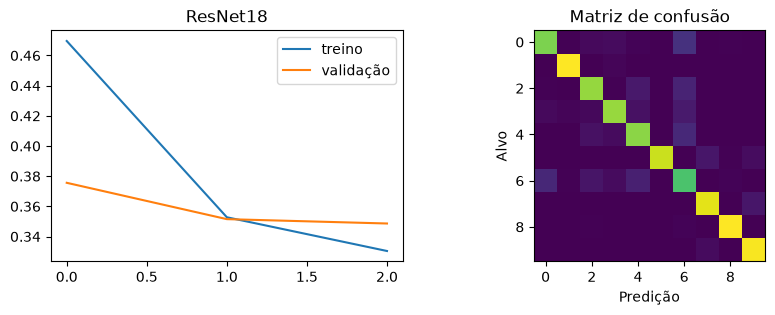
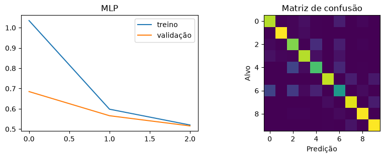
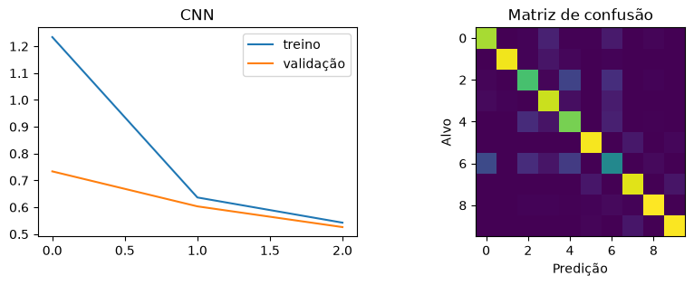

# FashionMNIST com PyTorch: MLP, CNN e transferência de aprendizado

Comparação prática de três abordagens para classificar imagens de roupas em dez categorias. O projeto percorre separação dos dados, treinamento, validação e avaliação final, com resultados e gráficos preservados no notebook.

**Autor:** Edson Santana Alves · **Contexto:** atividade acadêmica de Deep Learning

## Resultados

Avaliação no conjunto oficial de teste do FashionMNIST, com 10.000 imagens, após três épocas por modelo:

| Modelo | Acurácia no teste | Parâmetros treináveis | Loss final de validação |
| --- | ---: | ---: | ---: |
| MLP | 82,00% | 203.530 | 0,5157 |
| CNN própria | 80,82% | 20.490 | 0,5261 |
| ResNet18 pré-treinada | 87,07% | 5.130 | 0,3486 |

A ResNet18 obteve a maior acurácia nesta execução. Seus 5.130 parâmetros treináveis pertencem apenas à camada final: o restante da rede permanece congelado e também participa da inferência. Esse número não representa o tamanho total nem o custo computacional da rede.



[Abrir o notebook executado](atividade_pratica_02.ipynb) · [Resultados em CSV](results/metrics.csv)

## Implementação

- Divisão reproduzível dos dados e DataLoaders para treino, validação e teste.
- MLP com camada escondida de 256 unidades e ativação ReLU.
- CNN própria com dois blocos convolucionais, ReLU e max pooling.
- Transferência de aprendizado com ResNet18 e pesos do ImageNet, treinando somente a camada final.
- CrossEntropyLoss, Adam e loss média ponderada pelo tamanho dos lotes.
- Avaliação sem gradientes, acurácia e matrizes de confusão.

## Protocolo experimental

| Item | Configuração |
| --- | --- |
| Treino / validação / teste | 51.000 / 9.000 / 10.000 imagens |
| Semente | 42 |
| Épocas | 3 por modelo (`QUICK = False`) |
| Batch MLP / CNN | 128 |
| Batch ResNet18 | 32 |
| Learning rate MLP / CNN | 0,0001 |
| Learning rate ResNet18 | 0,001 |
| Execução registrada | CPU |

MLP e CNN recebem imagens de um canal em 28 × 28. Para a ResNet18, as imagens são convertidas para três canais e passam pelo pré-processamento oficial dos pesos, com saída 224 × 224 e normalização ImageNet. As três abordagens usam os mesmos índices de treino e validação. O conjunto de teste é avaliado após o treinamento das três configurações.

## Executar no VS Code

Requisitos: Python 3.10 ou superior, extensões Python e Jupyter do VS Code e acesso à internet para o primeiro download dos dados e pesos.

No terminal PowerShell, dentro da pasta do projeto:

```powershell
py -m venv .venv
.\.venv\Scripts\python.exe -m pip install --upgrade pip
.\.venv\Scripts\python.exe -m pip install -r requirements.txt
```

1. Abra `atividade_pratica_02.ipynb` no VS Code.
2. Selecione o kernel Python da pasta `.venv`.
3. Para conferir o fluxo com subconjuntos pequenos, use `QUICK = True`. Esse modo não reproduz os resultados da tabela.
4. Para o experimento completo, use `QUICK = False`.
5. Reinicie o kernel e execute todas as células na ordem.

O código seleciona CUDA quando disponível; caso contrário, usa CPU. A instalação acima não garante suporte à GPU. Para configurar CUDA, consulte o [instalador oficial do PyTorch](https://pytorch.org/get-started/locally/). A ResNet18 em 224 × 224 exige mais processamento que as redes menores.

As dependências não estão fixadas em um arquivo de lock; versões e hardware podem alterar resultados e tempo de execução. O notebook contém saídas salvas, mas não inclui checkpoints dos modelos treinados.

## Análise e limitações

As perdas de treino e validação diminuíram nos três modelos. A CNN usou menos parâmetros treináveis que a MLP, mas sua acurácia foi inferior nesta configuração. A transferência de aprendizado apresentou o melhor resultado observado.

Esta comparação utiliza uma semente e três épocas, sem uma busca ampla de hiperparâmetros. Portanto, não estabelece uma superioridade geral entre arquiteturas. Próximos experimentos podem comparar sementes e ajustar configurações usando validação, reservando uma avaliação independente para a versão final.

<details>
<summary>Gráficos da MLP e da CNN</summary>





</details>

## Origem da atividade

Este projeto é uma resolução da [atividade prática 02 do repositório deep-learning-pratica](https://github.com/o-kbc/deep-learning-pratica/blob/main/atividades/atividade_pratica_02.ipynb). O enunciado e a estrutura inicial são provenientes desse material; as respostas e a execução documentam a resolução da atividade. Os IDs das células de resposta foram preservados.

Tecnologias: Python, PyTorch, torchvision, NumPy, Pillow, matplotlib e Jupyter.
